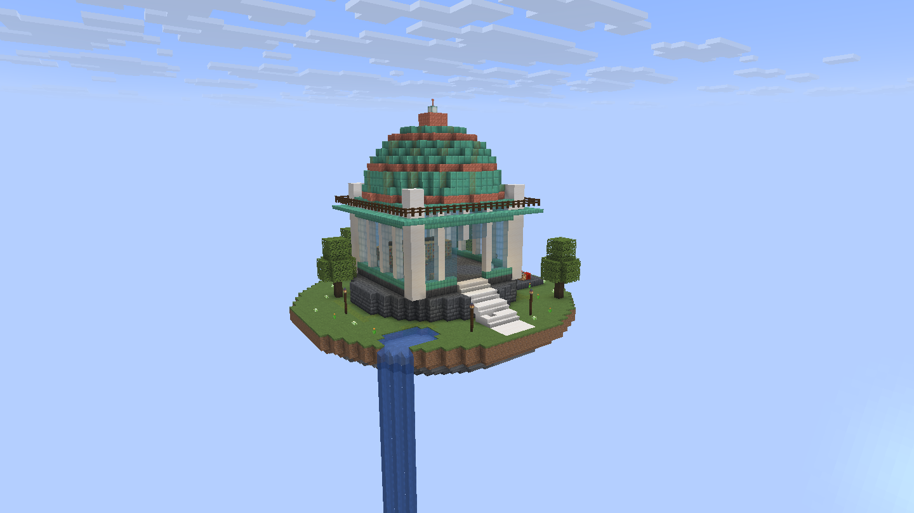
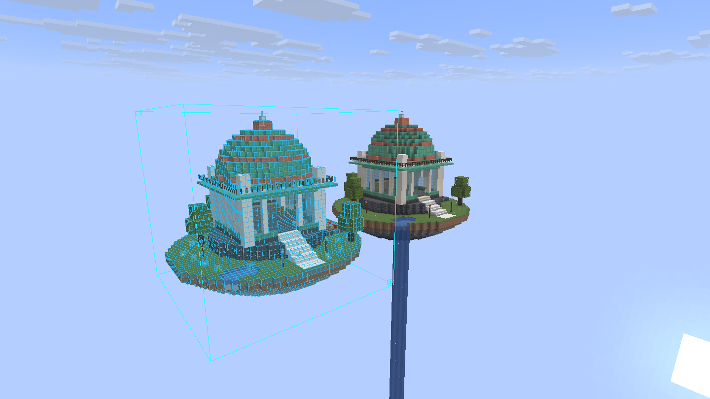
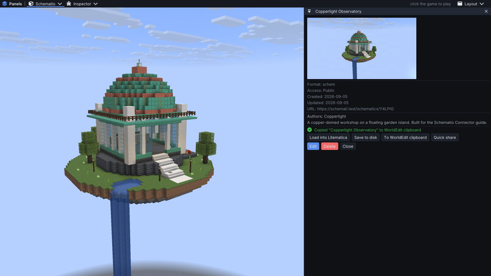
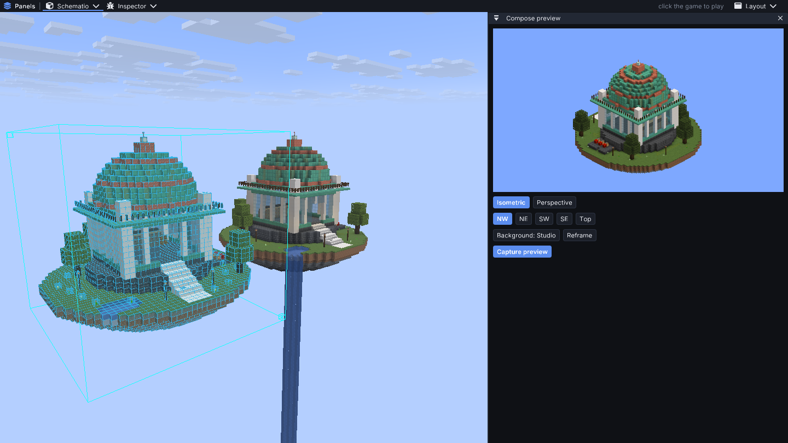
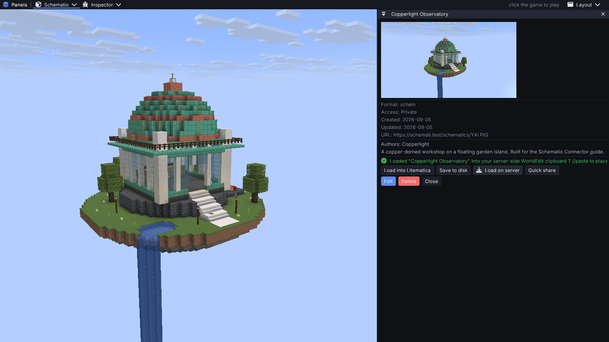
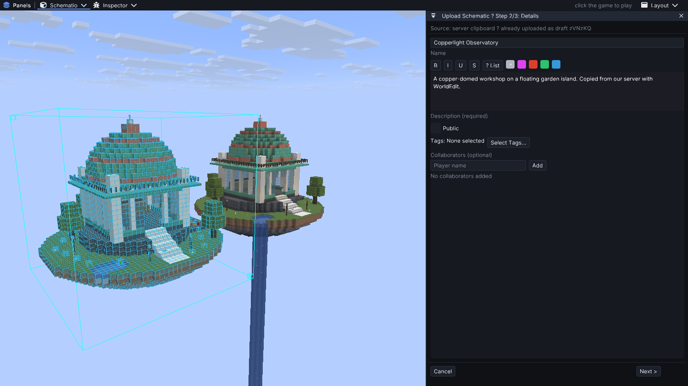

# Schematio Connector

Schematio Connector brings your [schemat.io](https://schemat.io) library into Minecraft. Browse a build, load it into Litematica or WorldEdit, and upload your own work from the game.

Choose what you want to use:

| Where you build | Install | What it connects |
| --- | --- | --- |
| On your own client | [Fabric mod](#the-mod-local-litematica-and-worldedit) | Your library, Litematica, local WorldEdit |
| On a community server | [Paper plugin](#the-plugin-schematio-and-server-worldedit) | Your community and server WorldEdit |
| With the mod on that server | [Both, with the bridge](#the-bridge-your-mod-detects-the-server) | The mod's interface and the server's clipboard |

<figure markdown="span">

<figcaption>Copperlight Observatory in Minecraft 26.2. The captures below use this same build in a local demonstration setup.</figcaption>
</figure>

[Download the example build](downloads/copperlight-observatory.zip) as a ZIP containing both `.litematic` and `.schem` files.

## Downloads

The files below are Connector 1.7.0, hosted by Schematio. This release adds [tools in game](#tools-in-game) to the mod and plugin, and shows schematic and community descriptions with their formatting. The [latest release on GitHub](https://github.com/Schem-at/SchematioConnector/releases/latest) always points to the newest published version.

<div data-article-downloads></div>

Expand a version row for requirements and its checksum. A single Paper jar covers all the listed server versions. See the [source code and issue tracker on GitHub](https://github.com/Schem-at/SchematioConnector).

## The plugin: Schematio and server WorldEdit

Install the Paper plugin on your server with WorldEdit. Players can download a schematic into their own WorldEdit clipboard, then choose where to paste it. They can also copy a build and upload it to the server's linked Schematio community. Players can use the plugin through commands and Minecraft's native dialogs without installing the client mod.

To install it, follow the [server setup](#server-setup) below.

<figure class="kg" data-static="media/server-workflow-720.svg">
<picture>
<source media="(max-width: 399px)" srcset="media/server-workflow-320.svg">
<source media="(max-width: 599px)" srcset="media/server-workflow-390.svg">
<source media="(max-width: 899px)" srcset="media/server-workflow-720.svg">

</picture>
<figcaption>Copperlight Observatory stays in your WorldEdit clipboard until you paste it.</figcaption>
</figure>

1. On Schematio, open a schematic's menu and choose **Copy in-game command**. It copies the complete download command for that build.
2. Open Minecraft chat, paste the command, and press **Enter**. Wait for the message confirming that WorldEdit's clipboard is ready.
3. Stand where you want the build, then run this command in chat:

```text
//paste
```

<figure class="minecraft-command-demo">
<picture>
<source media="(max-width: 399px)" srcset="media/minecraft-command-320.svg">
<source media="(max-width: 599px)" srcset="media/minecraft-command-390.svg">
<source media="(max-width: 899px)" srcset="media/minecraft-command-720.svg">

</picture>
</figure>

To upload a build, mark its corners with WorldEdit's selection tool, run `//copy`, then `/schematio upload`. Follow the prompts to name the schematic and finish the upload. The community token gives the plugin access to the community; the player remains credited as the author.

The server's usual WorldEdit permissions still apply. `schematio.upload` defaults to operators; server owners can grant it through their permissions plugin. The [command and permission reference](https://github.com/Schem-at/SchematioConnector#commands) covers the remaining controls.

## Server setup

These steps connect a Paper server to your Schematio community. You need to be an administrator of that community.

1. **Install the jars.** Put the Connector Paper jar and a WorldEdit plugin jar in `plugins/`, then restart the server. For Minecraft 1.21.x servers running Java 21, use WorldEdit 7.3.19. WorldEdit 7.4.x requires Java 25.
2. **Create a token.** On Schematio, open your community's settings and choose **Plugin API Tokens**, then **Create Plugin Token**. Name it after the server. **Full Access (Upload, Read, Manage)** includes uploads, downloads and **Run Tools Remotely**. **Upload Only** and **Read Only** leave out tools. Tokens cannot be edited, and one created before tools were added never gains them. Create a new Full Access token and replace the old one with `settoken`.
3. **Install the token.** In the **server console**, type `schematio settoken `, paste the token after the space, and press **Enter**. The console command has no leading slash. The token stays on the server; players never enter it in chat. Give each server its own token, so you can revoke one without disconnecting the others.
4. **Check the connection.** Run `/schematio info`. It reports the plugin version, whether WorldEdit was found, whether a token is configured, and the API status.

The settings live in `plugins/SchematioConnector/config.yml`. Run `/schematio reload` after editing it.

| Key | Default | Purpose |
| --- | --- | --- |
| `community-token` | empty | The token from step 2. `settoken` writes it for you. |
| `api-endpoint` | `https://schemat.io/api/v1` | Leave unchanged unless you run your own Schematio. |
| `rate-limit-requests`, `rate-limit-window-seconds` | `10`, `60` | Requests each player may make per window, tool runs included. |
| `cache-enabled`, `cache-ttl-seconds` | `true`, `300` | Keeps schematic listings for browsing while Schematio is unreachable. |
| `default-ui-mode` | `chat` | `chat` or `dialog`. Players can change their own with `/schematio settings`. |
| `disabled-commands` | none | Subcommands to remove, for example `tool` or `upload`. |

Grant permissions with LuckPerms or another permissions plugin, for example `/lp group builder permission set schematio.upload true`.

| Node | Default | Allows |
| --- | --- | --- |
| `schematio.download` | everyone | Downloading schematics into your WorldEdit clipboard |
| `schematio.upload` | operators | Uploading your WorldEdit clipboard |
| `schematio.quickshare` | everyone | Creating and opening quick shares |
| `schematio.tool` | everyone | Running Schematio tools on your clipboard |
| `schematio.clipboard.load`, `schematio.clipboard.upload` | everyone | The mod's server clipboard actions |
| `schematio.admin` | operators | `settoken`, `reload` and other admin commands |

Schematio still checks every player itself. A permission node lets a player try an action. Their Schematio account and community role decide whether it succeeds.

## Communities

A Schematio community groups the players behind a server. Its token connects the server, and its roles decide what each member may do.

Only **active members** count. A player who left, was removed, or never accepted an invitation is not a member, whatever their role was. Players link their Minecraft account to their Schematio profile, so the server knows who is who.

Roles carry permissions. Administrators edit them under the community's roles settings. The one that matters for this guide is **Run tools remotely as the community**. When a member's role includes it, that member can run Schematio tools in game, either through this server's plugin or from the mod with the community selected. Their runs count against the community's quota, not their own. By default only the Admin role has it. The community's creator also has it, as long as they are still an active member. Add it to other roles to open tools to more members. Tools stop working for everyone if the community itself is deactivated.

A player outside any community can still run tools from the mod if Schematio has granted tool access to their own account.

## The mod: local Litematica and WorldEdit

Install [Fabric Loader](https://fabricmc.net/use/installer/), then put the Connector jar for your Minecraft version in `mods/` with [Fabric API](https://modrinth.com/mod/fabric-api) and [Fabric Language Kotlin](https://modrinth.com/mod/fabric-language-kotlin). Connector requires Fabric Language Kotlin 1.13.12 or later. The panel interface is included.

Join a world and press **K** to open the overlay. Choose **Schematio → Browse**, or run `/schematio`. Your Minecraft session is used to sign in to Schematio. Open a schematic to see its preview, description, authors, and download actions. **Save to disk** works without either building tool installed.

For Litematica, install [Litematica](https://modrinth.com/mod/litematica) and [MaLiLib](https://modrinth.com/mod/malilib) for your Minecraft version. Click **Load into Litematica** on a schematic. Connector downloads the Litematica format and creates a placement at your position. Use Litematica's placement controls to move or rotate it, then build against the hologram. This works in singleplayer and multiplayer.

<figure markdown="span">

<figcaption>The placement on the left came from Load into Litematica. The solid build on the right was pasted with WorldEdit.</figcaption>
</figure>

For a local WorldEdit clipboard, install the [WorldEdit Fabric mod](https://modrinth.com/plugin/worldedit) for your Minecraft version. In singleplayer, or when hosting a LAN world, the schematic's details offer **To WorldEdit clipboard**. Run a WorldEdit command such as `//pos1` once to create your session, then click the clipboard action and run `//paste`. To upload from that clipboard, select your build and run `//copy` before opening **Schematio → Upload**. Local clipboard access requires the integrated server running in your game; on a dedicated server, use the plugin bridge described below.

<figure markdown="span">

<figcaption>To WorldEdit clipboard loads the integrated server's clipboard. The green message confirms the copy; //paste places it.</figcaption>
</figure>

The upload wizard also accepts local files and Litematica selections or placements. Fill in the name, description, visibility, tags, and co-authors. Use **Compose preview** to frame the schematic before uploading: orbit the model, pan, zoom, choose a camera preset, and capture a PNG.

<figure markdown="span">

<figcaption>The preview composer renders the schematic inside Minecraft. Here the isometric view frames the whole island without the waterfall flowing in the live world.</figcaption>
</figure>

## The bridge: your mod detects the server

When you join a Paper server running Connector, the mod and plugin detect one another automatically. The plugin supplies the linked community's signed identity. The mod verifies it through Schematio before enabling the advertised server actions. Your client never needs the community's token.

<figure class="kg" data-static="media/bridge-detection-720.svg">
<picture>
<source media="(max-width: 399px)" srcset="media/bridge-detection-320.svg">
<source media="(max-width: 599px)" srcset="media/bridge-detection-390.svg">
<source media="(max-width: 899px)" srcset="media/bridge-detection-720.svg">

</picture>
<figcaption>Joining triggers detection and identity verification. A verified connection enables the server clipboard tools.</figcaption>
</figure>

With the community connection verified and WorldEdit available, a schematic's details show **Load on server**. Click it to have the plugin fetch the schematic into your server-side WorldEdit clipboard. Access is checked against your linked Schematio account. Run `//paste` to place it.

<figure markdown="span">

<figcaption>The green message confirms the completed server load. The mod sends the request; the plugin downloads the file and fills WorldEdit's clipboard.</figcaption>
</figure>

For the reverse trip, select and copy a build with WorldEdit, then choose **Schematio → Upload clipboard to server** in the overlay. The plugin uploads your clipboard to Schematio as a draft. The mod checks that the draft belongs to your account and opens it for you to finish. Add its details and choose its visibility before saving.

<figure markdown="span">

<figcaption>The server clipboard arrives as a draft for the player to complete in the mod.</figcaption>
</figure>

Server owners control these bridge actions with `schematio.clipboard.load` and `schematio.clipboard.upload`; both default to allowed. A failed identity check, unavailable WorldEdit, or denied permission prevents the corresponding action. The Fabric server mod has its own server commands; this automatic plugin bridge uses Paper.

## Tools in game

Schematio tools create or transform builds. Connector runs them on Schematio and loads the result back into the game. You need **Run tools remotely as the community** in your role, or tool access on your own account; see [Communities](#communities).

<figure class="kg" data-static="media/tool-workflow-720.svg">
<picture>
<source media="(max-width: 399px)" srcset="media/tool-workflow-320.svg">
<source media="(max-width: 599px)" srcset="media/tool-workflow-390.svg">
<source media="(max-width: 899px)" srcset="media/tool-workflow-720.svg">

</picture>
<figcaption>The tool runs on Schematio. Its result replaces your WorldEdit clipboard, ready to paste.</figcaption>
</figure>

On a server with the plugin, list the tools your role allows:

<figure class="minecraft-command-demo">
<picture>
<source media="(max-width: 399px)" srcset="media/tool-command-320.svg">
<source media="(max-width: 599px)" srcset="media/tool-command-390.svg">
<source media="(max-width: 899px)" srcset="media/tool-command-720.svg">

</picture>
</figure>

Click a tool in the list to put its command in chat, add any settings as `name=value`, and press **Enter**. Tab completion suggests each tool's settings and, where there is a fixed choice, their values. Some tools need a setting before they can run, such as `username=` for a statue. Put quotes around a value with spaces, such as `label="north tower"`. If a tool takes a schematic, it uses your WorldEdit clipboard, so copy the build with `//copy` first. Progress appears above your hotbar. When the tool finishes, the result replaces your WorldEdit clipboard; run `//paste` to place it. Run `/schematio tool cancel` to stop a run. Tools that need an image or another file must be run from the mod.

In the mod, open **Schematio → Tools**. Pick a tool and fill in its form. For a schematic input, choose your WorldEdit clipboard, a Litematica placement or selection, or a file from your schematics folder. For a file input, such as an image or a 3D model, paste the path to the file. If you can run tools for more than one community, choose which one under **Run as**. Click the **Run** button below the form. A schematic result loads like any other download: into the server's or your local WorldEdit clipboard, or into Litematica, in the order set in Settings. Other results, such as images, are saved in a `tools` folder inside the folder where the mod saves downloads.

A run keeps going if you close the panel; reopen **Tools** to see its progress.

## Troubleshooting

If the mod fails to load, match the Minecraft version in the jar's filename and update Fabric API and Fabric Language Kotlin. Check that Litematica and MaLiLib also match your game version.

If **Load on server** is missing, check that the Paper plugin and WorldEdit started, the community token is configured, and the server identity check succeeded. Rejoin after replacing a token. A denied download can also mean your Minecraft account is not linked to Schematio, or that the schematic is private to someone else.

If no tools appear, check that your role includes **Run tools remotely as the community** and that you are an active member. On a server, also check that its token includes **Run Tools Remotely** and that you have `schematio.tool`.

Client settings let you disable requests from the server to open Schematio windows. This is useful if you prefer to open the overlay yourself.

Report problems in the [GitHub issue tracker](https://github.com/Schem-at/SchematioConnector/issues). Include your Minecraft and Connector versions, whether you use the mod or plugin, and the steps that failed. Remove tokens and account credentials from logs before attaching them.
